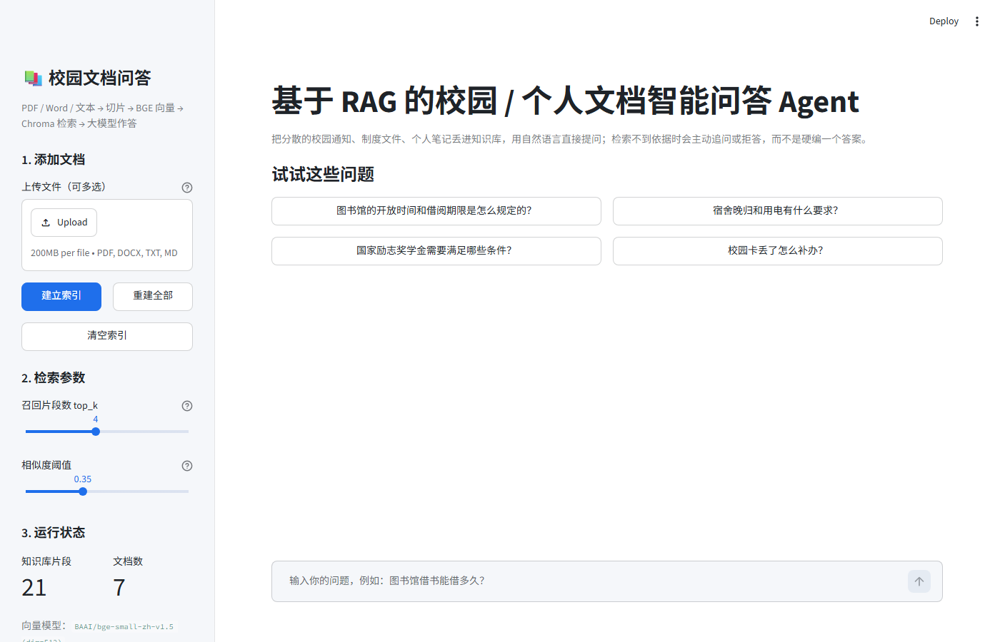
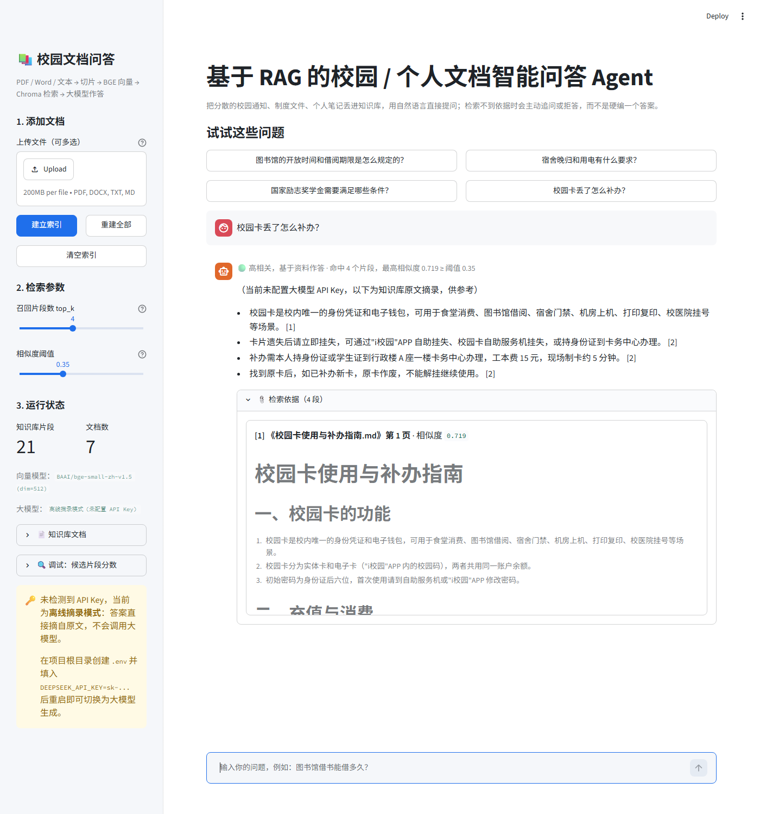
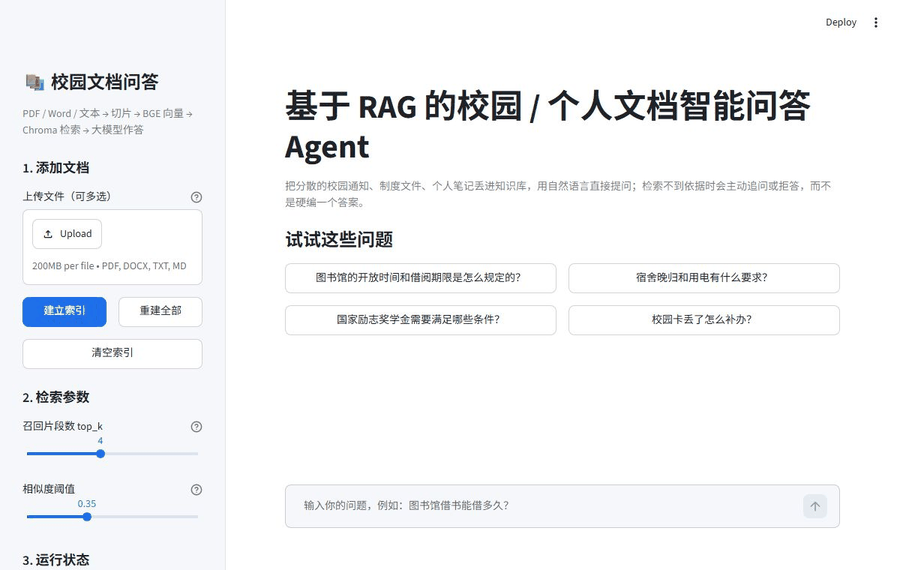
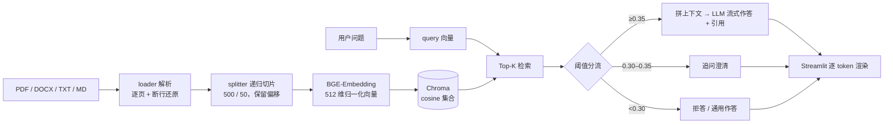

# 基于 RAG 的校园 / 个人文档智能问答 Agent

把散落的校园通知、办事指南、个人笔记（PDF / Word / TXT / Markdown）切片、向量化后存进 Chroma，
用户用自然语言提问时先检索、再让大模型「只依据检索到的资料」作答，并流式输出。

关键在于**不是把所有问题都硬塞给大模型**：检索相似度低于阈值的请求会被分流成「追问澄清」或「明确拒答」，
从源头减少幻觉；没有配置 API Key 时自动退回**离线摘录模式**，整条链路仍然可跑、可演示。

| 首页 | 提问与引用 |
| --- | --- |
|  |  |

---

## 0. 演示（不用装环境也能先看）

- **动图**：`demo/demo.gif`（19 帧，真实浏览器录屏：首页 → 输入问题 → 逐字流式输出 → 展开检索依据）
  
- **三态截图**：`demo/screenshots/` 下 `01_home` / `02_answer`（🟢 命中 0.719）/ `03_clarify`（🟡 追问 0.306）/ `04_refuse`（🔴 拒答 0.235）
- **一键启动**：双击项目根目录的 `启动演示.bat`（或 `python demo/start_demo.py`）。
  它会检查依赖 → 索引为空时自动建库 → 起 Streamlit → 打开浏览器，全程不用敲命令。
- **讲解词**：`demo/演示脚本.md`（30 秒版 / 90 秒版 + 面试追问 Q&A）

---

## 1. 它做了什么

| 能力 | 实现 |
| --- | --- |
| 文档解析 | PDF（PyMuPDF 逐页，pypdf 兜底，含中文断行还原）、DOCX（段落 + 表格）、TXT / MD / CSV（多编码嗅探） |
| 文本切片 | 自实现 `RecursiveCharacterTextSplitter`：按 `\n\n → \n → 。！？ → ；， → 空格 → 字符` 逐级回退，`chunk_size=500`、`chunk_overlap=50`，保留原文偏移量 |
| 向量化 | `BAAI/bge-small-zh-v1.5`（512 维，`sentence-transformers`，查询加 BGE 官方前缀）；模型不可用时自动降级为字符 n-gram 哈希向量 |
| 向量库 | Chroma 持久化集合，`hnsw:space=cosine`，相似度 = `1 - distance` |
| 检索 | Top-K 语义检索 + 相似度阈值；返回每个片段的分数用于调试 |
| 低相关度分流 | `ANSWER / CLARIFY / REFUSE / GENERAL` 四态：命中→作答；弱相关→追问澄清；不相关→拒答（或按配置通用作答） |
| 答案生成 | OpenAI 兼容协议（DeepSeek / OpenAI），同步 + 异步双接口，逐 token 流式；强制 `[序号]` 引用检索片段 |
| 离线兜底 | 无 Key 时不调大模型，用「句级语义相似度 0.85 + IDF 加权关键词 0.15」从命中片段的原句中选出 4 句，按原文顺序拼成带引用的摘录 |
| 界面 | Streamlit 单页应用：上传建库、参数调节、运行状态、检索依据展开、候选分数表 |
| 工程化 | 43 个单元测试、建库脚本、检索评测脚本（含阈值扫描）、环境自检、UI 冒烟测试、CDP 截图脚本 |

---

## 2. 三分钟跑起来

### 2.1 安装

```bash
cd rag-qa-agent
python -m venv .venv
.venv\Scripts\python.exe -m pip install -r requirements.txt -i https://pypi.tuna.tsinghua.edu.cn/simple
```

> 国内下载 BGE 模型需要镜像，项目已在 `rag/embeddings.py` 里默认设置 `HF_ENDPOINT=https://hf-mirror.com`、
> `HF_HOME=<项目>/.hf-cache`，首次加载会下载约 90MB 并缓存到本地。

### 2.2 建库 + 提问（命令行）

```bash
.venv\Scripts\python.exe scripts\build_index.py --reset
.venv\Scripts\python.exe cli.py ask "校园卡丢了怎么补办？"
```

输出示例：

```
🟢 命中知识库  命中 4 个片段，最高相似度 0.719 ≥ 阈值 0.35

答：（当前未配置大模型 API Key，以下为知识库原文摘录，供参考）

- 校园卡是校内唯一的身份凭证和电子钱包，可用于食堂消费、图书馆借阅、宿舍门禁…… [1]
- 卡片遗失后请立即挂失，可通过"i校园"APP 自助挂失、校园卡自助服务机挂失，或持身份证到卡务中心办理。 [2]
- 补办需本人持身份证或学生证到行政楼 A 座一楼卡务中心办理，工本费 15 元，现场制卡约 5 分钟。 [2]

依据：
  [1] 《校园卡使用与补办指南.md》p.1  相似度 0.719
  [2] 《校园卡使用与补办指南.md》p.1  相似度 0.714
```

### 2.3 启动界面

```bash
run.bat                              # 自动选 .venv 解释器并打开 http://localhost:8501
# 或者
.venv\Scripts\python.exe -m streamlit run app.py
```

### 2.4 开启大模型

复制 `.env.example` 为 `.env`，填入任一 Key：

```ini
DEEPSEEK_API_KEY=sk-xxxxxxxx
LLM_MODEL=deepseek-chat
```

`LLM_PROVIDER=auto` 会按 `DEEPSEEK_API_KEY → OPENAI_API_KEY` 的顺序自动选择；把 `LLM_PROVIDER` 设为
`offline` 可强制离线摘录模式。用 OpenAI 时额外设置 `LLM_BASE_URL=https://api.openai.com/v1`。

---

## 3. 工作流程



### 3.1 切片为什么自己实现

LangChain / LlamaIndex 早期版本提供的 `RecursiveCharacterTextSplitter` 是「按分隔符优先级逐级回退 + 滑窗重叠」的经典做法，
但本项目需要**每个片段的原文偏移量**（用于高亮与去重），而 `llama-index-core 0.14` 已移除该类（只剩按 token 计数的
`SentenceSplitter`，与本项目的 500 字符口径不一致）。因此按同样的思路自实现了一个同名、同参数的切片器
（`rag/splitter.py`），中文标点用 lookbehind 切分，保证句号留在上一句末尾，重叠时也不会把句子劈开。

### 3.2 相似度阈值怎么定的

用 19 条标注问题（15 条库内、4 条库外）跑阈值扫描，观察「作答 / 追问 / 拒答」的分布：

| 阈值 | 作答 | 追问 | 拒答 | 说明 |
| ---: | ---: | ---: | ---: | --- |
| 0.30 | 18 | 0 | 1 | 太松，库外问题也会被当成命中 |
| **0.35** | **15** | **3** | **1** | 库内全命中，库外问题进入追问或拒答 |
| 0.40 | 15 | 0 | 4 | 更严格，但追问带消失 |
| 0.50 | 13 | 2 | 4 | 开始误杀库内问题 |
| 0.55 | 8 | 6 | 5 | 明显误杀 |

实测相似度分布：库内问题 top1 落在 **0.451–0.712**，库外问题 **0.235–0.314**，中间有一道天然空隙，
0.35 正好落在空隙里，因此默认取 `SIM_THRESHOLD=0.35`；`WEAK_RATIO=0.85` 把 `[0.2975, 0.35)` 划为「弱相关」带，
让这类问题走追问而不是直接拒答——既不硬编答案，也不冷冰冰地说「不知道」。

### 3.3 流式是怎么实现的

`pipeline.stream_answer()` 返回事件流：先 `retrieval`（含路由结果与候选分数），再若干个 `token`，最后 `done`。
CLI 直接用 `print(token, end="")`，Streamlit 用 `st.empty()` + `st.write_stream` 风格的占位符刷新；
`pipeline.astream_answer()` 是同一逻辑的 `async` 版本（`AsyncOpenAI` + `async for`），可用
`python cli.py async-demo "…"` 验证。大模型调用失败（超时 / 无 Key / 限流）时自动降级为离线摘录，前端不报错。

---

## 4. 实测数据

环境：Windows 11 / Python 3.12 / CPU（无 GPU）。

| 指标 | 结果 |
| --- | --- |
| 建库（7 篇文档，含 1 个 PDF） | 21 个片段，1.0 s |
| 向量模型 | BAAI/bge-small-zh-v1.5，512 维，首次加载约 33 s（之后走本地缓存） |
| Hit@1 | 100%（15/15） |
| Hit@4 | 100%（15/15） |
| MRR | 1.000 |
| 库外问题拒答准确率 | 100%（4/4，其中 3 条进入澄清带、1 条直接拒答） |
| 单元测试 | 43 个用例全部通过（约 1.9 s） |

`scripts/eval_retrieval.py` 可复现上述结果：

```bash
.venv\Scripts\python.exe scripts\eval_retrieval.py          # 指标
.venv\Scripts\python.exe scripts\eval_retrieval.py --sweep  # 阈值扫描表
```

---

## 5. 目录结构

```
rag-qa-agent/
├─ app.py                     # Streamlit 界面
├─ cli.py                     # 命令行：build / ask / chat / serve / async-demo
├─ run.bat                    # 一键启动（自动选解释器、缺依赖则安装）
├─ 启动演示.bat                # 一键演示：查依赖 → 建库 → 起界面 → 开浏览器
├─ requirements.txt
├─ .env.example               # 配置模板
├─ rag/
│  ├─ config.py               # 集中配置（dataclass + 环境变量）
│  ├─ schemas.py              # Doc / Chunk / Page / Route / SearchResult / Answer
│  ├─ loader.py               # 多格式解析 + 中文断行还原 + 编码嗅探
│  ├─ splitter.py             # RecursiveCharacterTextSplitter（含偏移量）
│  ├─ embeddings.py           # BGE 向量 + 哈希兜底
│  ├─ store.py                # Chroma 持久化封装
│  ├─ retriever.py            # Top-K 检索 + 阈值分流
│  ├─ generator.py            # 提示词、LLM 客户端、离线摘录、流式生成
│  └─ pipeline.py             # 串联全流程的门面
├─ scripts/
│  ├─ build_index.py          # 建库（documents + samples）
│  ├─ eval_retrieval.py       # 检索指标 + 阈值扫描
│  ├─ check_env.py            # 环境自检（依赖 / 模型 / 库 / LLM）
│  ├─ smoke_ui.py             # Streamlit AppTest 冒烟
│  ├─ capture_ui.py           # 用 Chrome DevTools Protocol 截图
│  ├─ record_demo.py          # 用 CDP 逐帧录制 → demo.gif
│  └─ make_sample_pdf.py      # 生成中文示例 PDF
├─ demo/                      # 演示包：启动器 / 动图 / 三态截图 / 讲解脚本
│  ├─ start_demo.py           # 一键启动（自检 → 建库 → 起服务 → 开浏览器）
│  ├─ demo.gif                # 真实浏览器录屏
│  ├─ screenshots/            # 01 首页 / 02 命中 / 03 追问 / 04 拒答
│  └─ 演示脚本.md              # 30s / 90s 讲解词 + 面试 Q&A
├─ tests/                     # 43 个 unittest 用例
├─ data/
│  ├─ documents/              # 6 篇中文样例制度文档（.md）
│  ├─ samples/                # 1 篇示例 PDF（教务处期末安排通知）
│  ├─ uploads/                # 界面上传的原始文件
│  └─ index/                  # Chroma 持久化 + meta.json
└─ docs/screenshots/          # 界面截图
```

---

## 6. 命令速查

| 命令 | 作用 |
| --- | --- |
| `python scripts/check_env.py [--fast]` | 检查依赖、模型、索引、LLM 状态 |
| `python scripts/build_index.py --reset` | 重建索引（documents + samples） |
| `python scripts/eval_retrieval.py [--sweep]` | 检索指标 / 阈值扫描 |
| `python cli.py ask "问题" [--show-candidates]` | 单次提问，`--show-candidates` 打印全部候选分数 |
| `python cli.py chat` | 连续对话（带最近 3 轮上下文） |
| `python cli.py async-demo "问题"` | 验证异步流式接口 |
| `python cli.py serve --port 8501` | 启动界面 |
| `python -m unittest discover -s tests` | 跑全部单测 |
| `python scripts/smoke_ui.py` | 无浏览器冒烟测试界面逻辑 |
| `python scripts/capture_ui.py --cdp-url http://127.0.0.1:9333 --out shot.png` | 截图（需先起无头 Chrome 的调试端口） |
| `python demo/start_demo.py [--rebuild]` | **一键演示**：自检 → 建库 → 起界面 → 开浏览器 |
| `python scripts/record_demo.py --question "…" --out demo/demo.gif` | 录制动图（CDP 逐帧） |

---

## 7. 配置项

| 环境变量 | 默认值 | 说明 |
| --- | --- | --- |
| `DEEPSEEK_API_KEY` / `OPENAI_API_KEY` | 空 | 为空时进入离线摘录模式 |
| `LLM_PROVIDER` | `auto` | `auto / deepseek / openai / offline` |
| `LLM_MODEL` | `deepseek-chat` | OpenAI 时默认 `gpt-4o-mini` |
| `LLM_BASE_URL` | `https://api.deepseek.com` | OpenAI 兼容网关地址 |
| `LLM_TEMPERATURE` / `LLM_MAX_TOKENS` | `0.2` / `1024` | 生成参数 |
| `CHUNK_SIZE` / `CHUNK_OVERLAP` | `500` / `50` | 切片长度与重叠 |
| `TOP_K` | `4` | 召回片段数 |
| `SIM_THRESHOLD` | `0.35` | 相似度阈值（余弦，0–1） |
| `WEAK_RATIO` | `0.85` | 弱相关带：`[阈值×0.85, 阈值)` 走追问 |
| `LOW_RELEVANCE_STRATEGY` | `clarify` | `clarify` 追问 / `refuse` 拒答 / `general` 无资料直答 |
| `EMBEDDING_BACKEND` | `auto` | `auto / bge / hash` |
| `EMBEDDING_MODEL` | `BAAI/bge-small-zh-v1.5` | 换模型会自动清空不兼容的旧索引 |
| `HF_ENDPOINT` | `https://hf-mirror.com` | 模型下载镜像 |

索引目录里存了 `meta.json`（模型、维度、切片参数、片段数）；切换模型或改动切片参数后，下次检索会自动重建索引并在界面提示。

---

## 8. 与简历条目的对应关系

| 简历里的描述 | 代码位置 |
| --- | --- |
| 实现 PDF、文本等文档的解析、切片及向量化处理 | `rag/loader.py`、`rag/splitter.py`、`rag/embeddings.py` |
| 基于 BGE-Embedding 和 ChromaDB 实现语义向量检索 | `rag/embeddings.py`（`BGEEmbedder`）、`rag/store.py`（`ChromaStore`） |
| 设计检索结果相似度阈值判断机制，对低相关度结果分流处理 | `rag/retriever.py`（`_route`，四态分流）、阈值扫描见 README §3.2 |
| 实现基于大模型的问答生成与流式输出 | `rag/generator.py`（`LLMClient.stream` / `AnswerGenerator.stream_answer`） |
| 使用 LlamaIndex 组织文档处理流程，采用 RecursiveCharacterTextSplitter 思路切片，500 / 50 | `rag/splitter.py`（同名同参，分隔符回退 + 偏移量）；见下方说明 |
| 使用异步生成与流式传输机制实现回答逐步输出 | `rag/pipeline.py`（`astream_answer`）、`cli.py async-demo` |
| 通过 Streamlit 构建交互界面 | `app.py`（上传、建库、参数调节、引用展开、候选分数表） |

> **关于 LlamaIndex**：`llama-index-core`（0.14）已移除 `RecursiveCharacterTextSplitter`，现存切片器
> （`SentenceSplitter` / `TokenTextSplitter`）按 **token** 计数，与本项目「500 字符」的口径不一致，
> 因此按该类的分隔符回退策略自实现了同名切片器（`rag/splitter.py`），参数与行为对齐，并额外保留偏移量。
> 若团队要求统一框架，装上 `llama-index-core` 后把 `RAGPipeline.make_chunks()` 里的
> `RecursiveCharacterTextSplitter` 换成 `llama_index.core.node_parser.SentenceSplitter` 即可
> （`Node.start_char_idx / end_char_idx` 可直接填充偏移量，改动不到 10 行）。

---

## 9. 已知限制与后续可做

- **离线摘录不是生成**：没有 Key 时答案由原文句子拼成，读起来不如大模型通顺，界面上会明确标注当前模式。
- **中文切分按字符数**，不是 token 数；对英文文档会略偏短。
- **表格解析**只做了逐行 `|` 拼接，复杂合并单元格会丢结构。
- **评测集只有 19 条**，且样例文档是自建的制度文件；换真实语料需要重新标注、重扫阈值。
- 可扩展方向：混合检索（BM25 + 向量）、查询改写、rerank（bge-reranker）、多轮问题消解、按文档权限过滤、把存储换成 pgvector。

---

## 10. 验证记录

```text
$ python -m unittest discover -s tests
Ran 43 tests in 1.905s
OK

$ python scripts/eval_retrieval.py
Hit@1 = 100.0%   Hit@4 = 100.0%   MRR = 1.000   拒答准确率 = 100.0%（15 条知识库内问题，4 条库外问题）

$ python scripts/smoke_ui.py
[OK] 页面标题：基于 RAG 的校园 / 个人文档智能问答 Agent
[OK] markdown 块 1 个，sidebar 控件 16 个
[OK] 提问后 markdown 长度 441，命中标记：知识库原文摘录
[OK] 会话状态 history 条数： 1

$ python demo/start_demo.py --check-only
[OK] 依赖齐全
[OK] 已有索引：21 个片段 / 7 篇文档
[OK] 向量模型：BAAI/bge-small-zh-v1.5 (dim=512)
[OK] 大模型：离线摘录模式（未配置 API Key）

$ python cli.py ask "推荐几部好看的科幻电影"        # 三态分流
🔴 知识库未收录 → 拒答  最高相似度仅 0.235 < 阈值 0.35，判定为知识库未收录
```

> 演示（`demo/demo.gif`）与三态截图是用 `scripts/record_demo.py` / `scripts/capture_ui.py`
> 通过 Chrome DevTools 协议实拍的真实界面，不是手绘 mock。
